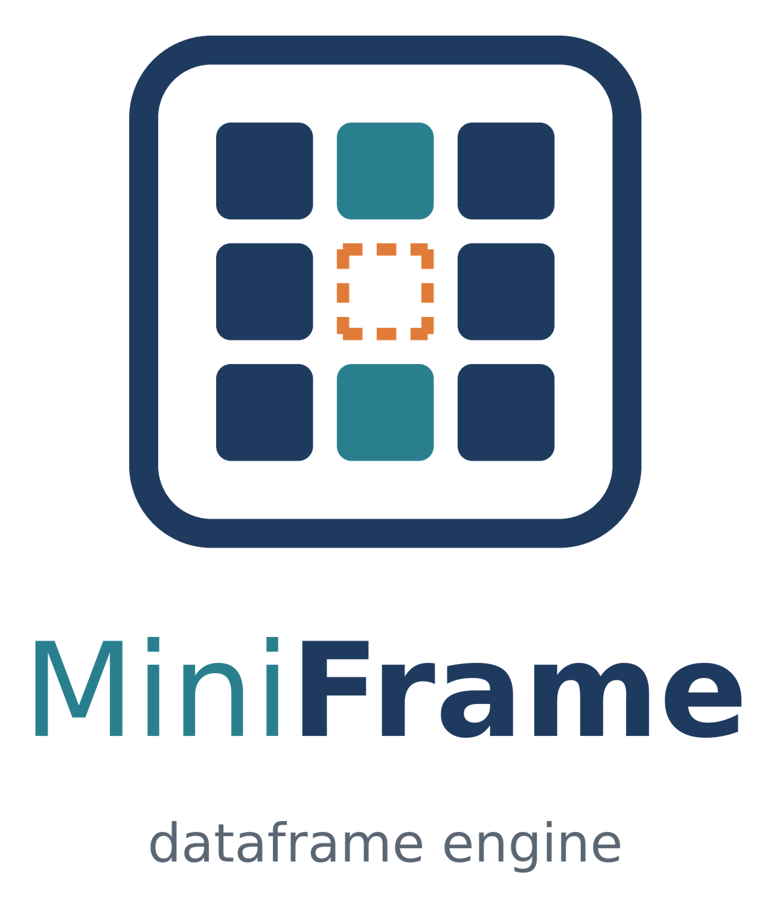
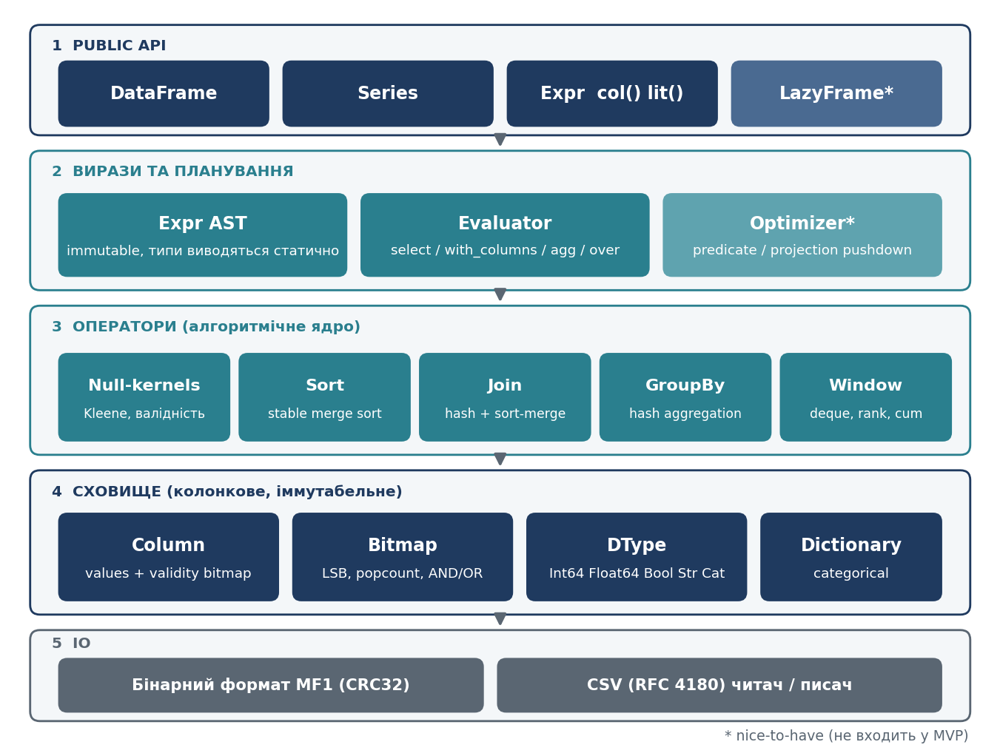
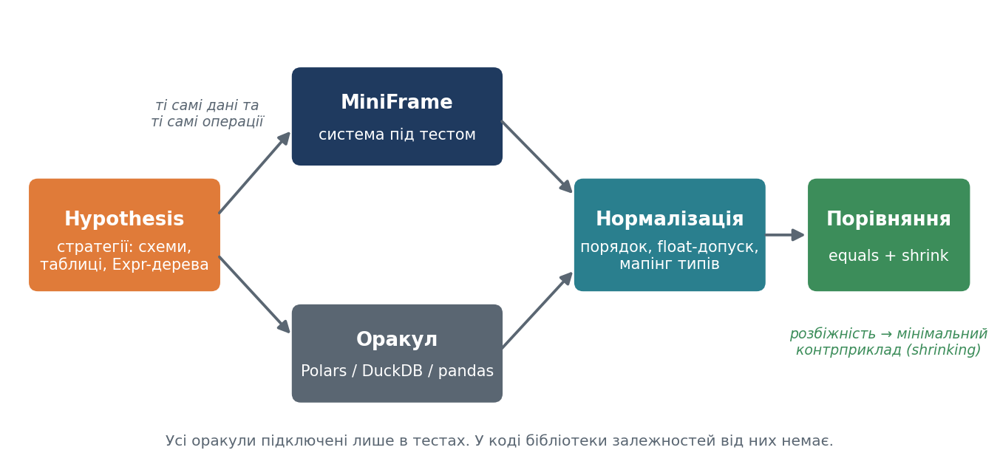

*DESIGN DOCUMENT*

# MiniFrame

Колонковий рушій таблиць з нуля: сховище, null-семантика, join, group by, віконні функції, власний формат і багаторівневе тестування

| **Параметр** | **Значення** |
| --- | --- |
| Тема | Власний DataFrame-рушій (аналог pandas) з Polars-стилем API |
| Автор | Марченко Данііл |
| Мова реалізації | Python 3.12 |
| Тестування | pytest, Hypothesis, coverage.py (branch), mutmut, pytest-benchmark |
| Оракули (тільки тести) | Polars, DuckDB, pandas, pyarrow |
| Версія документа | 1.0 (чернетка для затвердження) |
| Дата | 9 жовтня 2026 |



## Зміст

[1. Огляд проєкту](#section-1)

[2. Контекст і мотивація](#section-2)

[3. Обсяг робіт (scope)](#section-3)

[4. Публічний API](#section-4)

[5. Семантика null і NaN](#section-5)

[6. Архітектура](#section-6)

[7. Модель зберігання даних](#section-7)

[8. Алгоритми ядра](#section-8)

[9. Розглянуті альтернативи та обмеження](#section-9)

[10. Стратегія тестування](#section-10)

[11. Тестування продуктивності](#section-11)

[12. Реєстр відхилень від оракулів](#section-12)

[13. Ризики](#section-13)

[14. План робіт](#section-14)

[15. Джерела](#section-15)

<a id="section-1"></a>

# 1. Огляд проєкту

**MiniFrame** це бібліотека на Python для роботи з табличними даними в пам'яті. Вона реалізована з нуля: власні колонкові буфери, власна модель null, власні алгоритми join, group by, сортування та віконних функцій. pandas, Polars і DuckDB не є залежностями бібліотеки. Вони використовуються **тільки в тестах як оракули** для порівняння результатів.

Дизайн публічного API орієнтований на Polars, а не на pandas: невелика кількість операцій, вирази замість сотні методів, іммутабельні об'єкти, відсутність індексу рядків. Внутрішня модель даних наслідує Apache Arrow: суцільні типізовані буфери та окремий бітовий масив для null.

## 1.1 Цілі

- Побудувати колонковий рушій таблиць із коректною семантикою null (трьохзначна логіка) і чітко описаною поведінкою у граничних випадках.

- Реалізувати алгоритмічне ядро понад 3000 рядків: сховище, ядра обчислень, сортування, join, group by, віконні функції, бінарний формат.

- Мати компактний публічний API, який можна пояснити за 10 хвилин і який не повторює проблем дизайну pandas.

- Побудувати багаторівневу систему тестування: unit, property-based для **кожного** компонента, differential проти зовнішніх оракулів, stateful, fuzzing, mutation testing, benchmark-тести.

## 1.2 Не цілі

- Повна сумісність API з pandas або Polars. Важлива семантична еквівалентність результатів у межах реалізованої підмножини операцій.

- Продуктивність на рівні pandas чи Polars. Їхнє ядро написане на C і Rust, наше на чистому Python.

- Робота з даними, що не вміщуються в пам'ять, багатопотоковість, мережевий доступ до даних.

## 1.3 Ключові рішення

| **Рішення** | **Обґрунтування** |
| --- | --- |
| Колонкове сховище: суцільний буфер значень і окремий validity bitmap | Однакова обробка null для всіх типів. Не потрібні sentinel-значення. Відповідає Arrow та аргументам зі статті Веса Маккінні. |
| Іммутабельні Series і DataFrame | Немає inplace, немає спільних посилань, що ламаються. Простіше міркувати про коректність і тестувати. |
| Публічний API у стилі Polars: вирази, контексти, без індексу рядків | pandas має один об'єкт із сотнями методів і кількома способами зробити те саме. Малий API легше специфікувати й покрити тестами. |
| Оракули: Polars і DuckDB основні, pandas допоміжний | Семантика null у Polars і DuckDB ближча до SQL. Розбіжності з pandas зафіксовані у реєстрі відхилень (розділ 12). |
| Два незалежні алгоритми join (hash і sort-merge) | Вони перевіряють один одного як внутрішні оракули. Це ловить помилки, які зовнішній оракул міг би пропустити через нормалізацію. |
| Ліниві обчислення і оптимізатор: nice-to-have | Дають сильну властивість (оптимізований план дорівнює неоптимізованому), але не входять у MVP, щоб не ризикувати обсягом. |

<a id="section-2"></a>

# 2. Контекст і мотивація

Дизайн спирається на статтю Веса Маккінні (автора pandas) «Apache Arrow and the 10 Things I Hate About pandas» і на архітектуру Polars. Стаття перелічує слабкі місця внутрішньої будови pandas. Нижче показано, які з них ми вирішуємо у MiniFrame, які свідомо ні, і чому.

## 2.1 Проблеми pandas і відповідь MiniFrame

| **Проблема pandas (зі статті)** | **Підхід MiniFrame** | **Статус** |
| --- | --- | --- |
| Колонка це масив вказівників на Python-об'єкти, погана локальність даних | Колонка це типізований суцільний буфер (array, bytearray). Рядки зберігаються як offsets + data (Arrow-стиль). | MVP |
| Пропущені значення реалізовані по-різному для різних типів, int з пропуском стає float | Окремий validity bitmap для всіх типів. Тип колонки не змінюється через наявність null. null і NaN це різні речі. | MVP |
| Складно контролювати пам'ять, тимчасові копії, спільні посилання | Іммутабельні колонки. Операції створюють нові колонки, старі не змінюються. | MVP |
| Слабка підтримка категоріальних даних | Тип Categorical як dictionary encoding: масив кодів і словник значень. | MVP |
| Складний, повільний і непередбачуваний groupby з довільним apply | Фіксований набір агрегатів, одноразовий прохід із хеш-таблицею акумуляторів, детермінований порядок груп. | MVP |
| Eager-обчислення створює проміжні об'єкти, немає плану запиту | LazyFrame: логічний план і оптимізатор (predicate і projection pushdown). | Nice-to-have |
| Додавання даних дороге, колонка це один масив | Колонки з чанків (chunked arrays). | Out of scope, є vstack із копіюванням |
| Дані мають бути повністю в RAM, немає memory-mapping | Бінарний формат має заголовок зі зміщеннями буферів, але читання повне. Memory-mapping не реалізується. | Out of scope |
| Один потік виконання, немає багатоядерності | Не розглядається. | Out of scope |
| Один об'єкт з сотнями методів, індекс рядків, мутації | Малий API у стилі Polars, без індексу, без мутацій. | MVP |

## 2.2 Що береться від Polars

- **Вирази** (col, lit, оператори, alias, агрегати). Вираз це опис обчислення, що виконується в певному контексті.

- **Контексти**: select, with_columns, filter, group_by().agg(), join, sort, over. Усе інше (drop, rename, head) допоміжні операції.

- **Відсутність індексу рядків.** Позиційний доступ є, мітковий немає. Це прибирає loc, iloc, reset_index.

- **Іммутабельність.** Кожна операція повертає новий об'єкт.

- **Окремі \`null\` і \`NaN\`**, суворі типи без неявних перетворень.

- **Lazy API** як опційна надбудова над тими самими операціями.

> **Ключова ідея.** Ми не копіюємо Polars. Його ядро багатопотокове, написане на Rust, має десятки типів і сотні виразів. Ми беремо принципи дизайну API і моделі даних, а реалізацію пишемо самі на мінімально потрібній підмножині.

<a id="section-3"></a>

# 3. Обсяг робіт (scope)

Обсяг розбитий на три рівні, щоб ризик не вийти за часові рамки був керованим. Усе, що в MVP, обов'язкове до здачі. Nice-to-have робиться лише після виконання критеріїв готовності MVP.

## 3.1 MVP

| **Компонент** | **Що входить** |
| --- | --- |
| Типи даних | Int64, Float64, Boolean, String, Categorical. Усі nullable. |
| Сховище | Колонка: буфер значень + validity bitmap + null_count. Рядки як offsets + data. Categorical як коди + словник. |
| Series | Конструктор, cast, арифметика, порівняння, булева логіка, is_null, fill_null, unique, sort, агрегати. |
| Вирази | col, lit, alias, арифметика, порівняння, & \| ~, cast, is_null, fill_null, агрегати, over. |
| DataFrame | select, with_columns, filter, sort, group_by().agg(), join, drop, rename, head, tail, unique, drop_nulls, vstack. |
| Join | inner, left, right, full, багатоколонкові ключі, дублікати ключів. Hash join і sort-merge join. |
| GroupBy | sum, mean, min, max, count, len, n_unique, std, var, first, last. Ключі з null. |
| Sort | Власний стабільний merge sort, багато ключів, descending, nulls_last. |
| Window | over, rolling_sum/mean/min/max, cum_sum/min/max, rank, shift. |
| IO | Бінарний формат MF1 з перевіркою цілісності, CSV (читання і запис). |
| Помилки | Ієрархія винятків із чітким контрактом. |

## 3.2 Nice-to-have (за наявності часу)

- LazyFrame, логічний план, оптимізатор (predicate pushdown, projection pushdown, constant folding), explain().

- Типи Date і Datetime.

- when().then().otherwise(), is_in.

- semi і anti join.

- Чанковане читання CSV потоком.

- Benchmark-порівняння з Polars для контексту.

## 3.3 Out of scope

- Багатопотоковість, розподілені обчислення, out-of-core обробка, memory-mapping.

- Індекс рядків і мітковий доступ (loc, iloc), MultiIndex, pivot.

- Довільні користувацькі функції (apply, map_elements).

- Формати Parquet, Excel, JSON, SQL-підключення.

- Вкладені типи (List, Struct), Decimal, Duration.

- Сумісність із форматом Arrow IPC. Збігається лише розкладка validity bitmap і offsets (розділ 7.3), що використовується для тестування.

## 3.4 Критерії готовності MVP

1.  Усі операції з розділу 3.1 реалізовані й мають публічну документацію (docstring із контрактом).

2.  Алгоритмічне ядро більше 3000 рядків (без тестів, CSV-обгортки, CLI).

3.  Branch coverage ядра не менше 90%.

4.  Mutation score на критичних модулях не менше 80%, живі мутанти проаналізовані й задокументовані.

5.  Differential-тести проти Polars і DuckDB проходять на заданих стратегіях, відомі розбіжності внесені в реєстр відхилень.

6.  Fuzzing бінарного формату: жодного винятку, крім CorruptedFileError, жодних зависань.

7.  Є звіт про benchmark із перевіркою очікуваної асимптотики.

<a id="section-4"></a>

# 4. Публічний API

Публічний API це контракт бібліотеки. Усе, що не описано в цьому розділі, вважається внутрішньою реалізацією і може змінюватися. Імпортується пакет як import miniframe as mf.

## 4.1 Принципи дизайну

| **Принцип** | **Що це означає на практиці** |
| --- | --- |
| Іммутабельність | Жодна операція не змінює існуючий об'єкт. df\['a'\] = ... викликає TypeError. Немає параметра inplace. |
| Малий набір операцій | Одна операція це один спосіб зробити річ. Немає синонімів на кшталт merge і join. |
| Вирази замість методів колонок | Обчислення описуються виразами col('x') + 1. Один вираз можна використати в select, with_columns, filter, agg. |
| Немає індексу рядків | Рядки мають лише позицію. Мітковий доступ відсутній. Порядок рядків завжди визначений і описаний для кожної операції. |
| Явна поведінка null | Кожна операція має описане правило для null (розділ 5). Жодних неявних перетворень типів: int з null лишається int. |
| Помилки замість мовчазних сюрпризів | Некоректні операції (відсутня колонка, невідповідність типів, переповнення) викликають типізований виняток. |
| Детермінізм | Той самий вхід завжди дає той самий вихід, включно з порядком рядків і порядком груп. |

## 4.2 Приклад використання

**приклад.py**

```python
import miniframe as mf
from miniframe import col, lit

orders = mf.DataFrame({
    'city':  ['Kyiv', 'Lviv', 'Kyiv', 'Odesa', None],
    'sales': [10, 20, 30, None, 50],
})
cities = mf.DataFrame({'city': ['Kyiv', 'Lviv'], 'region': ['center', 'west']})

result = (
    orders
    .filter(col('sales') > 15)                         # null відкидається
    .with_columns((col('sales') * 2).alias('sales2'))
    .join(cities, on='city', how='left')               # null-ключ не зіставляється
    .group_by('region')
    .agg(col('sales').sum().alias('total'),
         col('sales').mean().alias('avg'),
         col('sales').len().alias('rows'))
    .sort('total', descending=True, nulls_last=True)
)

mf.write_mf(result, 'result.mf')        # власний бінарний формат
assert mf.read_mf('result.mf').equals(result)
```

## 4.3 Типи даних

| **Тип** | **Фізичне представлення** | **Приклад значень** |
| --- | --- | --- |
| Int64 | array('q'), 8 байт на значення | -2^63 ... 2^63-1 |
| Float64 | array('d'), IEEE 754 | 1.5, inf, NaN, -0.0 |
| Boolean | Bitmap значень (1 біт на значення) | True, False |
| String | offsets: array('i') + data: bytearray (UTF-8) | '', 'Київ', 'a,b' |
| Categorical | codes: array('i') + словник унікальних рядків | 'low', 'mid', 'high' |

Кожен тип nullable. Для кожної колонки існує окремий validity bitmap, де біт 1 означає «значення є», біт 0 означає null. Тип колонки визначається схемою, а не наявністю null.

## 4.4 Series

**miniframe/series.py (контракт)**

```python
class Series:
    def __init__(self, name: str, values: Iterable[Any],
                 dtype: DType | None = None) -> None

    name: str                       dtype: DType
    def __len__(self) -> int
    null_count: int                  # O(1), зберігається в метаданих
    def to_list(self) -> list[Any]  # null -> None
    def __getitem__(self, i: int) -> Any
    def slice(self, offset: int, length: int) -> Series

    # перетворення і null
    def cast(self, dtype: DType) -> Series            # строго, інакше ComputeError
    def is_null(self) -> Series                       # Boolean, ніколи не null
    def is_not_null(self) -> Series
    def fill_null(self, value: Any) -> Series
    def unique(self) -> Series                         # порядок першої появи
    def sort(self, *, descending=False, nulls_last=False) -> Series

    # оператори: + - * /  ==  !=  <  <=  >  >=  &  |  ~

    # агрегати (повертають скаляр)
    def sum / mean / min / max / count / len / n_unique / std / var / first / last

    def equals(self, other: Series, *, null_equal: bool = True) -> bool
```

## 4.5 Вирази

Expr це іммутабельне дерево обчислення. Створюється функціями col(name) і lit(value) та методами й операторами над виразами. Обчислюється тільки в контексті DataFrame.

| **Група** | **Операції** | **Результат у контексті** |
| --- | --- | --- |
| Джерела | col(name), lit(value) | колонка висоти h або скаляр |
| Арифметика | \+ - \* / і унарний - | колонка. / завжди повертає Float64 |
| Порівняння | == != \< \<= \> \>= | Boolean колонка (з null) |
| Логіка | & \| ~ (Kleene) | Boolean колонка (з null) |
| Null | is_null, is_not_null, fill_null(v) | колонка |
| Типи | cast(dtype), alias(name) | колонка |
| Агрегати | sum mean min max count len n_unique std var first last | скаляр. У agg одне значення на групу |
| Вікна | over(\*keys), rolling_sum/mean/min/max(window_size, min_periods=None), cum_sum/min/max, rank(method, descending), shift(n) | колонка тієї ж висоти |

### Правила контекстів

- У select і with_columns вираз повертає колонку висоти df.height або скаляр, який розтягується на всю висоту (broadcast).

- У filter вираз має повертати Boolean. Залишаються лише рядки зі значенням **true**. Значення false і null відкидаються.

- У agg кожен вираз має зводитися до одного значення на групу (в корені дерева стоїть агрегат). Інакше ShapeError.

- over(keys) обчислює агрегат по групах і розтягує його на всі рядки групи. Висота результату дорівнює висоті таблиці.

- Ім'я результату береться з першої col(...) у виразі або з alias. Дублікати імен у результаті select дають SchemaError.

## 4.6 DataFrame

**miniframe/frame.py (контракт)**

```python
class DataFrame:
    def __init__(self, data: Mapping[str, Iterable[Any]] | None = None, *,
                 schema: Mapping[str, DType] | None = None) -> None
    @classmethod
    def from_series(cls, series: Sequence[Series]) -> DataFrame

    shape: tuple[int, int]   height: int   width: int
    columns: list[str]       schema: dict[str, DType]
    def column(self, name: str) -> Series          # df['name'] лише для читання

    def select(self, *exprs: ExprLike) -> DataFrame
    def with_columns(self, *exprs: ExprLike) -> DataFrame
    def filter(self, predicate: Expr) -> DataFrame
    def sort(self, by, *, descending=False, nulls_last=False) -> DataFrame
    def group_by(self, *keys: str | Expr) -> GroupBy
    def join(self, other: DataFrame, *, on=None, left_on=None, right_on=None,
             how: Literal['inner','left','right','full'] = 'inner',
             suffix: str = '_right') -> DataFrame

    def drop(self, *names: str) -> DataFrame
    def rename(self, mapping: Mapping[str, str]) -> DataFrame
    def head(self, n: int = 5) -> DataFrame
    def tail(self, n: int = 5) -> DataFrame
    def unique(self, subset: Sequence[str] | None = None) -> DataFrame
    def drop_nulls(self, subset: Sequence[str] | None = None) -> DataFrame
    def vstack(self, other: DataFrame) -> DataFrame

    def to_dicts(self) -> list[dict[str, Any]]
    def rows(self) -> list[tuple[Any, ...]]
    def equals(self, other: DataFrame, *, null_equal: bool = True) -> bool
    def lazy(self) -> LazyFrame                     # nice-to-have

class GroupBy:
    def agg(self, *exprs: Expr) -> DataFrame
```

## 4.7 Контракти ключових операцій

### Join

| **Аспект** | **Контракт** |
| --- | --- |
| Ключі | on для однойменних колонок або пара left_on / right_on. Підтримується кілька колонок. Типи ключів мають збігатися, інакше SchemaError. |
| Дублікати | Кожна пара рядків із рівними ключами дає один рядок результату (декартів добуток по ключу). Розмір inner join дорівнює сумі за ключами cntL(k) \* cntR(k). |
| null у ключі | Рядок із null у будь-якій колонці ключа ніколи не зіставляється. У left, right, full такий рядок потрапляє в результат як незіставлений. |
| NaN і -0.0 | NaN зіставляється з NaN. -0.0 дорівнює 0.0. Це відрізняється від порівняння == у виразах (розділ 12). |
| Порядок рядків | Результат впорядкований за позицією лівого рядка, а в межах одного лівого рядка за позицією правого. Для right і full незіставлені праві рядки додаються в кінець у порядку правої таблиці. |
| Колонки результату | Усі колонки лівої таблиці, потім колонки правої без ключових. Колізії імен отримують суфікс suffix. Ключова колонка одна й та сама для всіх how (для full береться значення з тієї сторони, де воно є). |
| Алгоритм | За замовчуванням hash join. Sort-merge join доступний внутрішньо й використовується в тестах як незалежна реалізація. |

### GroupBy

- Ключем може бути одна чи кілька колонок (або виразів). Рядки з null у ключі утворюють **власну групу**. NaN теж утворює одну групу.

- Порядок груп у результаті завжди збігається з порядком **першої появи** ключа у вхідній таблиці.

- Результат містить спочатку колонки ключів, потім агрегати в порядку перерахування.

- Агрегати пропускають null. Правила для порожніх і повністю null груп наведено в розділі 5.

### Sort

- Сортування **стабільне**: рядки з однаковими ключами зберігають відносний порядок. Це зберігається і для descending=True.

- descending може бути списком (окремо для кожного ключа). nulls_last визначає положення null незалежно від напрямку.

- NaN у Float64 вважається більшим за будь-яке число.

## 4.8 LazyFrame (nice-to-have)

**lazy-API**

```python
lf = orders.lazy().filter(col('sales') > 15).select('city', 'sales')
print(lf.explain())                 # текстове дерево плану (оптимізованого)
df = lf.collect(optimize=True)      # результат має дорівнювати optimize=False
```

LazyFrame має ті самі методи, що й DataFrame, але не виконує нічого до collect(). Головна гарантія: collect(optimize=True), collect(optimize=False) і eager-виконання дають однаковий результат.

## 4.9 IO

**miniframe/io (контракт)**

```python
mf.write_mf(df: DataFrame, path: str) -> None          # бінарний формат MF1
mf.read_mf(path: str) -> DataFrame                      # CorruptedFileError
mf.write_csv(df: DataFrame, path: str) -> None
mf.read_csv(path: str, *, schema=None, null_values=('',)) -> DataFrame
```

## 4.10 Помилки

| **Виняток** | **Коли виникає** |
| --- | --- |
| MiniFrameError | Базовий клас усіх помилок бібліотеки. |
| SchemaError | Невідповідність типів, дубльовані імена колонок, несумісні ключі join. |
| ColumnNotFoundError | Посилання на неіснуючу колонку. |
| ShapeError | Різна довжина колонок, вираз у agg не зводиться до скаляра. |
| ComputeError | Переповнення Int64, неможливий cast, інші помилки обчислення. |
| CorruptedFileError | Пошкоджений або некоректний файл формату MF1. Єдиний виняток, дозволений при читанні довільних байтів. |

<a id="section-5"></a>

# 5. Семантика null і NaN

Саме null-семантика є джерелом більшості граничних випадків у таблицях. Цей розділ є специфікацією. Тести будуються безпосередньо з нього.

> **Ключова ідея.** null означає «значення відсутнє» і можливий у будь-якому типі. NaN це звичайне значення типу Float64. Вони не плутаються: NaN не є null, а null не є NaN.

## 5.1 Трьохзначна логіка Kleene

Булеві значення мають три стани: True, False, null (невідомо). Результат відомий, якщо його можна визначити незалежно від невідомого операнда.

| **a** | **b** | **a & b** | **a \| b** |
| --- | --- | --- | --- |
| True | True | True | True |
| True | False | False | True |
| True | null | null | True |
| False | True | False | True |
| False | False | False | False |
| False | null | False | null |
| null | True | null | True |
| null | False | False | null |
| null | null | null | null |

~True = False, ~False = True, ~null = null.

### Векторна реалізація через bitmap

Для колонок із значеннями v і валідністю m (біт 1 означає відоме значення), за умови що значення в null-позиціях нормалізовані до 0, операції виконуються над цілими словами бітів без перебору елементів:

**kleene.txt**

```text
AND:  valid = (m1 & m2) | (m1 & ~v1) | (m2 & ~v2)      value = v1 & v2
OR :  valid = (m1 & m2) | (m1 &  v1) | (m2 &  v2)      value = v1 | v2
NOT:  valid = m                                         value = ~v & m
```

Перша формула читається так: результат AND відомий, якщо обидва операнди відомі, або хоча б один із них відомо хибний. Ці формули і є предметом property-тесту «векторна версія дорівнює скалярній еталонній реалізації на Python з None».

## 5.2 Правила для операцій

| **Операція** | **Правило** |
| --- | --- |
| Арифметика + - \* / | Якщо будь-який операнд null, результат null. |
| Порівняння == != \< \<= \> \>= | Якщо будь-який операнд null, результат null. Зокрема null == null дає null. |
| is_null, is_not_null | Ніколи не повертають null. |
| fill_null(v) | Замінює null на v. v має відповідати типу колонки. |
| filter(pred) | Залишає лише рядки з pred = True. False і null відкидаються. |
| Переповнення Int64 | Виняток ComputeError (перевірена арифметика). Відхилення від оракулів, див. розділ 12. |
| Ділення / | Операнди приводяться до Float64. x/0.0 дає ±inf, 0/0.0 дає NaN. Ціле ділення не підтримується. |
| cast | null лишається null. Некоректне значення (наприклад 'abc' у Int64) дає ComputeError. |
| Агрегати: sum | Пропускає null. Сума порожньої або повністю null колонки дорівнює 0 (або 0.0). |
| Агрегати: mean, min, max | Пропускають null. Для порожньої або повністю null колонки результат null. |
| Агрегати: std, var | Вибіркові (ddof = 1), алгоритм Велфорда. Якщо непорожніх значень менше двох, результат null. |
| Агрегати: count, len | count рахує не-null значення, len рахує всі рядки. |
| Агрегати: n_unique | null вважається окремим значенням. |
| first, last | Повертають перше й останнє значення групи, включно з null. |
| sort | nulls_last задає положення null (за замовчуванням null першими). NaN більше за всі числа. Сортування стабільне. |
| group_by | null і NaN утворюють по одній групі. |
| join | null у ключі не зіставляється. NaN зіставляється з NaN. -0.0 дорівнює 0.0. |
| unique | null вважається одним значенням. NaN також. |
| rolling\_\* | Вікно містить window_size останніх рядків. Враховуються лише не-null значення. Якщо їх менше min_periods, результат null. За замовчуванням min_periods = window_size. |
| cum_sum, cum_min, cum_max | У null-позиції результат null, накопичення продовжується по не-null значеннях. |
| rank | Методи average, min, max, dense, ordinal. Для null результат null, null не впливає на ранги решти. |
| shift(n) | Звільнені позиції заповнюються null. |

> **Важливо.** Усі правила, де можлива розбіжність між оракулами (n_unique, NaN у порівняннях, сума порожньої групи, переповнення), винесені в **реєстр відхилень** (розділ 12) і перевіряються проти конкретних зафіксованих версій Polars і DuckDB.

<a id="section-6"></a>

# 6. Архітектура

Бібліотека складається з п'яти шарів. Верхні шари залежать від нижніх, зворотних залежностей немає. Шар операторів не знає про вирази, шар сховища не знає про оператори. Це дозволяє тестувати кожен шар окремо.

## 6.1 Структура пакета

**структура**

```text
miniframe/
├── dtype.py            # DType, правила сумісності типів
├── bitmap.py           # Bitmap: set/get, popcount, AND/OR/NOT, зрізи
├── column.py           # Column: values + validity + null_count (іммутабельна)
├── errors.py
├── kernels/
│   ├── logic.py        # Kleene &, |, ~ над bitmap
│   ├── arithmetic.py   # + - * / з перевіркою переповнення
│   ├── compare.py      # порівняння з null і NaN
│   └── cast.py
├── series.py
├── expr.py             # Expr AST, col, lit, оператори
├── eval.py             # обчислення Expr у контексті
├── frame.py            # DataFrame, GroupBy
├── ops/
│   ├── sort.py         # стабільний merge sort по перестановці індексів
│   ├── join.py         # hash join + sort-merge join
│   ├── groupby.py      # хеш-агрегація, акумулятори
│   └── window.py       # rolling, cum, rank, over
├── io/
│   ├── mf_format.py    # бінарний формат MF1
│   └── csv_io.py       # CSV (RFC 4180)
└── lazy/               # nice-to-have: plan.py, optimizer.py
```



*Рисунок 1. Шари MiniFrame (\* означає nice-to-have)*

## 6.2 Бюджет обсягу ядра

Оцінка рядків коду без тестів і без csv_io.py. Вона потрібна, щоб показати запас відносно мінімуму курсу (3000 рядків алгоритмічного ядра) і побачити, що можна скоротити, якщо часу не вистачатиме.

| **Модуль** | **Орієнтовно рядків** | **Тип** |
| --- | --- | --- |
| dtype.py, errors.py | 200 | ядро |
| bitmap.py | 200 | ядро |
| column.py (буфери, рядки, categorical) | 450 | ядро |
| kernels/\* (логіка, арифметика, порівняння, cast) | 450 | ядро |
| series.py | 350 | ядро |
| expr.py + eval.py | 500 | ядро |
| frame.py | 400 | ядро |
| ops/sort.py | 300 | ядро |
| ops/join.py (hash + sort-merge) | 500 | ядро |
| ops/groupby.py | 450 | ядро |
| ops/window.py | 350 | ядро |
| io/mf_format.py | 350 | ядро |
| Разом MVP | ≈ 4500 |  |
| io/csv_io.py | 250 | не рахується |
| lazy/\* (nice-to-have) | 500 | ядро, понад MVP |

> **Ключова ідея.** Навіть якщо повністю прибрати віконні функції (−350) і зменшити решту на 20%, лишається понад 3000 рядків алгоритмічного коду. Запас дозволяє не роздувати код заради цифри.

<a id="section-7"></a>

# 7. Модель зберігання даних

## 7.1 Колонка

Column це іммутабельна структура з трьох частин: буфер значень, validity bitmap і закешований null_count.

| **Тип** | **Буфер значень** | **Особливості** |
| --- | --- | --- |
| Int64 | array('q') | Значення в null-позиціях дорівнює 0 (канонічне). |
| Float64 | array('d') | У null-позиції лежить 0.0. NaN це значення, null окреме. |
| Boolean | Bitmap значень | Той самий клас, що й для validity. Канонічно 0 у null-позиціях. |
| String | offsets: array('i') довжини n+1, data: bytearray | Рядок i це data\[offsets\[i\]:offsets\[i+1\]\] у UTF-8. Для null offsets\[i\] == offsets\[i+1\]. |
| Categorical | codes: array('i') + dictionary: tuple\[str\] | Для null код 0, значення береться з validity. |

## 7.2 Інваріанти сховища

Інваріанти перевіряються функцією Column.check_invariants(), яка викликається в тестах після кожної операції (і в debug-режимі бібліотеки):

1.  len(values) == length (для рядків len(offsets) == length + 1, offsets\[0\] == 0, offsets неспадні, offsets\[-1\] == len(data)).

2.  len(validity) == ceil(length / 8) байтів, біти за межами length дорівнюють 0.

3.  null_count == length - popcount(validity).

4.  Значення в null-позиціях нормалізовані (0, порожній рядок). Завдяки цьому порівняння буферів можна робити побайтово, а Kleene-формули з розділу 5.1 коректні.

5.  Після створення буфери не змінюються. Будь-яка операція створює нову колонку.

6.  Для String дані є коректним UTF-8, для Categorical кожен код менший за розмір словника.

## 7.3 Сумісність розкладки з Arrow

Розкладка validity bitmap (нумерація бітів від молодшого, 1 означає «є значення») і буфера offsets для рядків навмисно збігається зі специфікацією Arrow Columnar Format. Це дає незалежний оракул для шару сховища: у тестах створюється та сама колонка в pyarrow, і значущі байти буферів порівнюються з нашими. Інші частини формату Arrow (padding до 64 байтів, IPC) не реалізуються.

Припущення: array('i') має розмір 4 байти, а порядок байтів little-endian. Це перевіряється assert при імпорті пакета.

## 7.4 Bitmap

Bitmap зберігає біти у bytearray. Операції AND, OR, NOT над двома bitmap виконуються через цілі числа Python: int.from_bytes(a, 'little') & int.from_bytes(b, 'little'). Це обробляє тисячі бітів однією операцією замість перебору елементів і є головним способом «векторизації» в чистому Python. popcount використовує int.bit_count().

<a id="section-8"></a>

# 8. Алгоритми ядра

## 8.1 Стабільне сортування

Сортування працює над **перестановкою індексів**, а не над самими даними. Результатом є масив perm, за яким колонки переставляються за допомогою take(perm). Це дозволяє однаково сортувати кілька колонок за одним порядком.

- Алгоритм: власний **bottom-up merge sort** (ітеративний, без рекурсії, щоб не залежати від ліміту стека Python). Складність O(n log n), додаткова пам'ять O(n).

- Стабільність забезпечується правилом злиття: при рівних ключах береться елемент лівої половини.

- Багато ключів: компаратор порівнює ключі по черзі. Напрямок descending обертає **результат порівняння ключа**, а не перевертає масив, тому стабільність зберігається.

- Порядок значень: у межах не-null значень за типом (для Float64 NaN більше за все), null розміщується на початку чи в кінці за nulls_last незалежно від напрямку.

- У коді ядра заборонено sorted() і list.sort(). Вони використовуються лише в тестах як еталон.

## 8.2 Join

### Hash join

1.  Побудувати хеш-таблицю на **правій** таблиці: ключ (кортеж значень ключових колонок) до списку позицій рядків. Рядки з null в будь-якій колонці ключа в таблицю не потрапляють. Ключі нормалізуються (-0.0 до 0.0, NaN до канонічного).

2.  Пройти по лівій таблиці в порядку позицій. Для кожного рядка знайти список правих позицій і додати пари (l, r) у результат. Для лівого рядка з null у ключі або без збігу в left і full додається пара (l, None).

3.  Для right і full під час побудови позначити використані праві позиції. Невикористані додаються в кінець як пари (None, r) у порядку правої таблиці.

4.  how='right' реалізується обміном таблиць і подальшою перестановкою колонок, щоб не дублювати код.

5.  За парами індексів зібрати колонки результату через take (з None у null-позиціях).

Складність: O(n + m + k), де k розмір результату. Результат детермінований за порядком (розділ 4.7).

### Sort-merge join

Незалежна реалізація: обидві таблиці сортуються за ключами (власним стабільним сортуванням), потім двома вказівниками знаходяться блоки рівних ключів, і для кожної пари блоків генерується декартів добуток. Результат потім приводиться до того самого порядку, що й у hash join. Мета цього алгоритму не швидкість, а **незалежна перевірка**: два різні алгоритми з однаковою специфікацією мають давати той самий результат.

> **Рішення.** Властивість hash_join(L, R) == sort_merge_join(L, R) для довільних таблиць ловить класи помилок, які легко пропустити при порівнянні із зовнішнім оракулом, бо нормалізація порядку може приховати помилку.

## 8.3 GroupBy

- Один прохід по таблиці. Для кожного рядка обчислюється кортеж ключа, за ним у dict знаходиться номер групи (нова група отримує наступний номер, звідси порядок першої появи).

- Для кожної групи і кожного агрегату зберігається стан акумулятора: sum тримає суму й прапорець переповнення, count лічильник, min/max поточний екстремум, mean пару (сума, кількість), std/var стан Велфорда (n, mean, M2), n_unique множину побачених значень, first/last значення.

- Алгоритм Велфорда обраний через чисельну стабільність: наївна формула E\[x²\] − E\[x\]² дає катастрофічне скорочення на великих значеннях з малим розкидом.

- Після проходу стани перетворюються на колонки результату. Тип результату: sum для Int64 дає Int64 (з перевіркою переповнення), mean/std/var дають Float64, count/len/n_unique дають Int64.

- Якщо вираз в agg складніший за простий агрегат (наприклад (col('a') \* 2).sum()), спочатку обчислюється вкладений вираз над усією таблицею, потім агрегується по групах.

- over(keys) використовує ті самі номери груп, але замість зведення розтягує значення агрегату назад на рядки.

## 8.4 Віконні функції

| **Функція** | **Алгоритм** | **Складність** |
| --- | --- | --- |
| rolling_sum, rolling_mean | Ковзна сума з додаванням нового і віднімання старого елемента, окремий лічильник не-null значень. Для Float64 періодичний перерахунок вікна з нуля для обмеження накопичення похибки. | O(n) |
| rolling_min, rolling_max | Монотонна черга (deque) з індексами: елементи, що виходять за вікно, видаляються з голови, нові штовхають з хвоста менші. | O(n) амортизовано |
| cum_sum, cum_min, cum_max | Один прохід з накопиченням, null пропускається. | O(n) |
| rank | Сортування за значенням (стабільне), потім прохід по блоках рівних значень і присвоєння рангів за методом. | O(n log n) |
| shift | Зсув перестановки індексів. | O(n) |
| over | Групування, агрегат по групі, розтягування. | O(n) |

Еталоном для rolling у тестах служить наївна реалізація O(n·k), яка для кожної позиції окремо рахує вікно.

## 8.5 Ядра обчислень над null

Кожне бінарне ядро (+, ==, & тощо) виконується двома кроками: (1) обчислення значень над буферами, (2) обчислення результуючої валідності. Для арифметики та порівнянь валідність результату це m1 & m2 (побітове AND bitmap). Для & і \| застосовуються формули Kleene з розділу 5.1. Значення в null-позиціях після операції нормалізуються до 0 (маскування), щоб зберегти інваріант 4.

Перевірка переповнення Int64 виконується для кожної арифметичної операції порівнянням результату з межами \[-2^63, 2^63-1\]. Оскільки Python має цілі довільної довжини, переповнення ловиться після обчислення і викликає ComputeError.

## 8.6 Бінарний формат MF1

Формат призначений для збереження DataFrame без втрат (типи, null, порядок, категорії). Розкладка спроєктована так, щоб заголовок описував точні розташування буферів. Це відповідає принципу Arrow, що дозволяє в майбутньому читати окремі колонки без читання всього файлу. У MVP файл читається повністю.

| **Блок** | **Зміст** |
| --- | --- |
| Magic | 4 байти MF1\0 |
| Версія | u16, поточна 1 |
| Заголовок | u32 num_rows, u32 num_cols, далі для кожної колонки: u16 довжина імені, ім'я (UTF-8), u8 тег типу, u8 прапорець наявності null, список дескрипторів буферів (u64 зміщення, u64 довжина, u32 CRC32) |
| CRC заголовка | u32 CRC32 усього заголовка |
| Буфери | Дані колонок: validity (за наявності null), values або offsets+data, codes+dictionary |
| Кінцевий magic | 4 байти для виявлення обрізаного файлу |

### Правила читача (захист від пошкоджень)

- Перед будь-яким виділенням пам'яті перевіряється, що заявлені зміщення й довжини вкладаються в розмір файлу. Число рядків і колонок обмежується розумними межами. Це захищає від «бомб пам'яті» (заявлено 4 ГБ у файлі на 100 байт).

- Перевіряються magic на початку й у кінці, версія, CRC заголовка і CRC кожного буфера.

- Після читання виконується check_invariants() для кожної колонки (offsets неспадні, коди в межах словника, коректний UTF-8).

- Будь-яке порушення дає CorruptedFileError з описом місця. Жоден інший виняток із читача не виходить, процес не зависає.

## 8.7 CSV

Читач реалізований як скінченний автомат за RFC 4180: поля в лапках, подвоєні лапки як екранування, коми й переноси рядків усередині лапок, різні закінчення рядків. Порожнє поле читається як null за замовчуванням (null_values). Типи колонок виводяться зі схеми або автоматично за значеннями (спочатку Int64, потім Float64, потім Boolean, інакше String). Запис екранує поля за тими самими правилами. Модуль не входить у підрахунок 3000 рядків.

## 8.8 Оптимізатор LazyFrame (nice-to-have)

| **Правило** | **Опис** | **Умова коректності** |
| --- | --- | --- |
| Predicate pushdown | Фільтр переміщується ближче до джерела: через select і with_columns, якщо колонки предиката не змінюються, і всередину відповідної сторони join. | Для left join не можна опускати предикат на праву сторону, а для inner можна. |
| Projection pushdown | Зберігаються лише колонки, потрібні подальшим операціям. | Колонки ключів і предикатів вважаються потрібними. |
| Об'єднання фільтрів | filter(p).filter(q) стає filter(p & q). | Kleene-логіка зберігає результат, бо filter відкидає false і null однаково. |
| Constant folding | Вирази над літералами обчислюються на етапі планування. | Ті самі ядра, що й у виконанні. |

<a id="section-9"></a>

# 9. Розглянуті альтернативи та обмеження

Нижче рішення, які розглядались і були відхилені, причина і ціна рішення (що ми втрачаємо).

| **Альтернатива** | **Чому відхилена** | **Що втрачаємо** |
| --- | --- | --- |
| Колонки на NumPy-масивах | Це був би шар над готовою бібліотекою, а не алгоритмічне ядро. NumPy також не має вбудованої підтримки null, довелося б будувати те саме поверх. | Швидкість векторних операцій на великих таблицях. |
| list\[Optional\[T\]\] як колонка | Кожен елемент окремий Python-об'єкт, погана локальність, null змішується зі значеннями, немає буферів для тестування розкладки. | Простота реалізації. |
| NaN як маркер пропуску | Не існує для Int64, Boolean, String. Змішує «відсутнє» і «не число». Саме це критикується у статті. | Нічого суттєвого. |
| API у стилі pandas (індекс, loc, iloc, inplace) | Дизайн pandas вважається слабким: один об'єкт із сотнями методів, кілька способів зробити те саме, мутації. | Знайомий синтаксис. |
| Рядкове сховище (list\[dict\]) | Немає колонкової локальності, ускладнює векторні ядра й bitmap-логіку, не відповідає темі. | Простіша вставка окремих рядків. |
| pandas як єдиний оракул | Семантика null відрізняється: groupby за замовчуванням відкидає null-ключі, merge зіставляє null-ключі між собою. Оракул суперечив би специфікації. | Один зручний оракул замість кількох. |
| Розширення на C або Rust | Виходить за часові рамки, ускладнює інструменти покриття й mutation testing, зміщує фокус із алгоритмів. | Швидкодія. |
| Сумісність з Arrow IPC | Окремий великий формат з власними граничними випадками. Для цілей курсу достатньо власного формату. | Обмін даними з іншими системами. |
| Chunked колонки | Ускладнюють усі ядра (потрібно працювати через межі чанків) без користі на тестових обсягах. | Дешеве додавання даних. Лишається vstack із копіюванням. |
| Лише hash join | Не було б незалежної перевірки коректності join. | Додаткові ~200 рядків коду. |

## 9.1 Відомі обмеження

- Чистий Python суттєво повільніший за pandas і Polars. Тестові таблиці очікуються розміром до 10⁴ рядків, benchmark до 10⁶.

- Усі дані мають вміщатися в пам'ять. Читання MF1 повне, memory-mapping немає.

- vstack копіює дані. Багаторазове додавання рядків у циклі має квадратичну вартість.

- Переповнення Int64 викликає помилку, а не обгортається (свідоме відхилення).

- Тип Float64 порівнюється за семантикою розділу 5. Відхилення від IEEE для NaN у join і групуванні задокументоване.

<a id="section-10"></a>

# 10. Стратегія тестування

Принцип: кожен компонент перевіряється кількома незалежними способами, і кожен спосіб ловить свій клас помилок. Щоб показати, що тести здатні виявити інжектовані баги, вони перевіряються mutation testing і набором вручну інжектованих помилок (розділ 10.8).

## 10.1 Рівні тестування

| **Рівень** | **Інструмент** | **Що ловить** |
| --- | --- | --- |
| Unit | pytest | Конкретні граничні випадки, таблиці істинності, формули адресації, контракти помилок. |
| Property-based | Hypothesis | Інваріанти для довільних даних: ідемпотентність, roundtrip, збереження кількості, стабільність, еквівалентність двох реалізацій. |
| Differential | Polars, DuckDB, pandas, pyarrow, csv | Розбіжності зі зовнішньою еталонною семантикою на випадкових таблицях і ланцюжках операцій. |
| Stateful | Hypothesis RuleBasedStateMachine | Помилки в довгих послідовностях операцій і при збереженні/читанні посеред конвеєра. |
| Fuzzing | Hypothesis binary + власні мутатори | Поведінка парсерів на пошкоджених і зловмисних вхідних даних. |
| Mutation | mutmut | Слабкі тести: мутанти, які тести не вбивають. |
| Coverage | coverage.py (branch) | Недосяжні або неперевірені гілки. |
| Performance | pytest-benchmark, tracemalloc | Регресії асимптотики й пам'яті. |

## 10.2 Property-based тести для кожного компонента

Для кожного модуля визначені власні властивості. Тут перелік основних. Стратегії Hypothesis (генератори даних) описані в розділі 10.3.

| Компонент | Властивості |
| --- | --- |
| Bitmap | • get(i) після set(i, b) повертає b, решта бітів не змінюється.<br>• popcount збігається з підрахунком через список булевих.<br>• AND, OR, NOT збігаються з поелементними операціями. ~~x == x, закони де Моргана. |
| Column | • Column.from_list(xs).to_list() == xs для всіх типів із null.<br>• check_invariants() не падає після будь-якої операції.<br>• Значущі байти буферів збігаються з pyarrow (розділ 7.3).<br>• take(perm) з перестановкою, а потім із зворотною повертає вихідну колонку. |
| Kleene-ядра | • Векторна версія дорівнює скалярній еталонній реалізації на Optional[bool].<br>• Де Морган: ~(a & b) == (~a) \| (~b) у трьохзначній логіці.<br>• Комутативність і асоціативність &, \|. a & a == a.<br>• Для відомих (не-null) операндів збігається з двозначною логікою. |
| Арифметика та порівняння | • Збігається зі скалярною реалізацією на Optional[int] і Optional[float].<br>• Результат null рівно там, де хоча б один операнд null.<br>• Переповнення завжди дає ComputeError, ніколи не повертає неправильне число. |
| Вирази та evaluator | • Випадкове дерево виразів дає той самий результат у MiniFrame і Polars.<br>• Обчислення виразу не змінює вхідну таблицю.<br>• select(e).height == df.height для не-агрегатів. |
| filter | • Комутативність: filter(p).filter(q) має ті самі рядки, що filter(q).filter(p).<br>• filter(p) ∪ filter(~p) ∪ filter(p.is_null()) розбиває таблицю (кількості додаються).<br>• Результат є підпослідовністю вхідної таблиці (порядок збережений). |
| sort | • Результат є перестановкою вхідного (мультимножина рядків та сама).<br>• Результат упорядкований за ключами з урахуванням descending і nulls_last.<br>• Стабільність: рівні за ключем рядки зберігають відносний порядок (перевіряється доданою колонкою позиції), включно з descending=True.<br>• Ідемпотентність: sort(sort(x)) == sort(x). |
| join | • hash_join == sort_merge_join на довільних вхідних даних.<br>• Розмір inner join дорівнює Σ cntL(k)·cntR(k) за ключами без null.<br>• Лівий join містить усі ліві рядки принаймні раз. inner ⊆ left, inner ⊆ right.<br>• left join і swap з right join еквівалентні з точністю до порядку колонок.<br>• full = inner ∪ незіставлені ліві ∪ незіставлені праві.<br>• Рядки з null-ключем ніколи не потрапляють у зіставлені пари. |
| group_by | • Сума len за групами дорівнює висоті таблиці.<br>• Кількість груп дорівнює кількості різних ключів (null рахується).<br>• Порядок груп збігається з порядком першої появи.<br>• sum групи дорівнює сумі, обчисленій фільтром за ключем.<br>• Перестановка рядків не змінює значення агрегатів (для цілих). |
| Window | • rolling_* збігається з наївною O(n·k) реалізацією.<br>• cum_sum[-1] == sum для таблиць без null на кінці.<br>• over не змінює висоту, а значення сталі в межах групи.<br>• rank для таблиці без дублікатів є перестановкою 1..n. |
| Series та агрегати | • std збігається з еталоном на малих значеннях і стійкий на великих із малим розкидом.<br>• mean * count ≈ sum.<br>• min ≤ mean ≤ max для непорожніх без NaN. |
| CSV | • read_csv(write_csv(df, ...), schema) == df для рядків із комами, лапками, переносами, Unicode.<br>• Результат збігається з модулем csv стандартної бібліотеки. |
| Формат MF1 | • read_mf(write_mf(df)) == df (типи, null, порядок, категорії).<br>• Будь-який обрізаний префікс файлу дає CorruptedFileError.<br>• Зміна будь-якого одного байта дає CorruptedFileError або (якщо байт не входить у перевірені області) ідентичний результат. |
| LazyFrame (якщо реалізований) | • collect(optimize=True) == collect(optimize=False) == eager.<br>• Кожне правило оптимізатора перевіряється окремо на випадкових планах. |

## 10.3 Стратегії Hypothesis

| **Стратегія** | **Призначення** |
| --- | --- |
| columns(dtype, null_rate, size) | Колонка заданого типу з контрольованою часткою null. Включає граничні значення: 0, ±2^63, NaN, ±inf, -0.0, порожні й довгі рядки, Unicode. |
| dataframes(schema) | Таблиця за схемою, включаючи порожню, з одним рядком, усі значення null, усі значення однакові. |
| join_pairs() | Дві таблиці зі спільними ключами. Контрольовані частки співпадінь, дублікатів, null у ключах. |
| expr_trees(schema, depth) | Випадкові типобезпечні дерева виразів із глибиною до заданої. |
| pipelines(schema) | Послідовності операцій filter, with_columns, sort, group_by, join для stateful-тестів. |

Профілі налаштувань: dev (100 прикладів), ci (500), mutation (30 прикладів, derandomize=True, deadline=None). Детермінований профіль для mutation testing потрібен, щоб результат не залежав від випадковості.

## 10.4 Differential testing



*Рисунок 2. Схема differential-тесту*

| **Оракул** | **Що перевіряє** |
| --- | --- |
| Polars (основний) | Вирази, фільтрація, сортування, group by, віконні функції, null-семантика. |
| DuckDB (основний) | Join усіх видів, group by, сортування. Запити генеруються як SQL з тих самих параметрів, що й виклики MiniFrame. |
| pandas (допоміжний) | Лише операції, де семантика збігається (з nullable-типами). Розбіжності не ховаються, а внесені в реєстр відхилень. |
| pyarrow (тільки тести) | Розкладка буферів колонки (validity, offsets, data). |
| csv (стандартна бібліотека) | Розбір і запис CSV. |

### Нормалізація перед порівнянням

- **Порядок рядків.** Якщо порядок не визначений специфікацією оракула, обидві таблиці сортуються за всіма колонками (null останніми). Якщо визначений (sort), порівнюється як є.

- **Float.** Порівняння з відносною похибкою 1e-9 (різний порядок додавання), NaN вважається рівним NaN. Цілі порівнюються точно.

- **Типи.** Мапінг: Int64 ↔ Int64/BIGINT, Float64 ↔ Float64/DOUBLE, Boolean ↔ Boolean/BOOLEAN, String ↔ String/VARCHAR, Categorical порівнюється як рядок.

- **Null.** Однозначно мапляться на None/NULL. NaN і null не змішуються.

- При розбіжності Hypothesis автоматично зменшує приклад (shrinking) до мінімального контрприкладу.

## 10.5 Stateful-тести

Оскільки API іммутабельний, «стан» тут це довгий конвеєр. Машина RuleBasedStateMachine тримає пару об'єктів (поточна таблиця MiniFrame і така сама в Polars) і набір побічних таблиць для join. Правила виконують випадкові операції на обох; після кожного кроку виконується перевірка.

- **Правила:** filter, with_columns, select, sort, group_by_agg, join_with_side_table, drop/rename, vstack, roundtrip_through_mf (запис і читання в середині конвеєра), roundtrip_through_csv.

- **Інваріанти після кожного кроку:** результат семантично дорівнює оракулу, check_invariants() для всіх колонок, висота й схема узгоджені.

- **Перевірка іммутабельності:** перед кроком зберігається знімок (хеш вмісту) попередньої таблиці, після кроку перевіряється, що вона не змінилась.

- Друга машина тестує окремо шар колонок: випадкові take, slice, concat, cast з перевіркою інваріантів і порівнянням зі списком Python.

## 10.6 Fuzzing

- **MF1:** мутатори (заміна байта, вставка, видалення, обрізання, зміна довжин на екстремальні 0xFFFFFFFF) над валідними файлами. Допускається лише CorruptedFileError. Перевіряються час виконання (таймаут) і пік пам'яті (tracemalloc), щоб не було «бомб».

- **CSV:** довільні байти як вхід. Допустимі результат або контрольований виняток, ніколи зависання.

- **Схеми та вирази:** випадкові (в тому числі некоректні) комбінації типів і операцій. Очікується SchemaError, ShapeError, ComputeError, але не AttributeError, IndexError чи інші неконтрольовані винятки.

## 10.7 Покриття і mutation testing

| **Метрика** | **Ціль** | **Область** |
| --- | --- | --- |
| Branch coverage | не менше 90% | Усе алгоритмічне ядро (без тестів) |
| Mutation score | не менше 80% | kernels/logic.py, kernels/compare.py, bitmap.py, ops/sort.py, ops/join.py, ops/groupby.py, ops/window.py, io/mf_format.py |
| Живі мутанти | 100% проаналізовані | Кожен живий мутант або вбивається новим тестом, або документується як еквівалентний |

- Mutation testing налаштовується в **перший тиждень** на мінімальному модулі, щоб знати реальну швидкість до того, як код виросте.

- Для швидких прогонів використовується профіль Hypothesis mutation і окремий швидкий набір тестів для кожного модуля.

- Повний прогін виконується періодично (nightly), а не на кожен коміт. Запасний інструмент: cosmic-ray.

## 10.8 Набір інжектованих багів

Тести перевіряються не лише автоматичними мутантами. Створюється каталог із 12 вручну інжектованих помилок (кожна в окремій гілці або через патч). Для кожної фіксується, який рівень тестів її ловить. Це відтворює ручну перевірку і гарантує, що кожен клас помилок покритий мінімум одним рівнем тестів.

| **\#** | **Інжектована помилка** | **Очікуваний рівень виявлення** |
| --- | --- | --- |
| 1 | Зсув на 1 при встановленні біта, коли індекс кратний 8 | Property: Bitmap; pyarrow-розкладка |
| 2 | null & False повертає null замість False | Unit: таблиця істинності; property: векторна проти скалярної |
| 3 | У merge sort \<= замінено на \< (втрата стабільності) | Property: стабільність sort |
| 4 | descending реалізовано розворотом масиву замість компаратора | Property: стабільність при descending=True |
| 5 | Hash join зіставляє null-ключі між собою | Unit; differential проти DuckDB і Polars |
| 6 | Left join втрачає лівий рядок, коли праворуч кілька дублікатів | Property: розмір і вміст left join |
| 7 | group_by відкидає групу з null-ключем | Property: сума len за групами; differential |
| 8 | Неправильне оновлення в алгоритмі Велфорда | Differential із допуском; property на великих значеннях |
| 9 | Монотонна черга не видаляє індекси, що вийшли з вікна | Property: rolling проти наївної реалізації |
| 10 | Читач MF1 пропускає перевірку меж зміщення | Fuzz: обрізання й екстремальні довжини |
| 11 | CRC буфера не перевіряється | Property: зміна одного байта виявляється |
| 12 | Predicate pushdown опущено на праву сторону left join | Property: оптимізований план дорівнює неоптимізованому |

<a id="section-11"></a>

# 11. Тестування продуктивності

Мета benchmark-тестів не у змаганні з Polars, а в перевірці того, що наші алгоритми мають заявлену складність, що колонкове сховище дає виграш у пам'яті, і що немає регресій між версіями.

## 11.1 Сценарії

| **Сценарій** | **Параметри** | **Що вимірюється** |
| --- | --- | --- |
| Sort | n = 10³ ... 10⁶, 1 і 3 ключі, частка null 0% і 30% | Час, ріст часу при подвоєнні n |
| Join | hash проти sort-merge, селективність, перекіс дублікатів (всі ключі однакові) | Час, розмір результату, пік пам'яті |
| GroupBy | кількість груп 10, 10³, 10⁵; 1 і кілька агрегатів | Час, пам'ять |
| Rolling | deque проти наївної O(n·k), вікно 10 і 1000 | Час, асимптотика |
| Filter / арифметика | n = 10⁶, булева маска з різною селективністю | Час |
| CSV та MF1 | читання і запис 10⁶ рядків | Час, пік пам'яті, розмір файлу |
| Пам'ять колонки | 10⁶ значень Int64 і String проти list | Байти на значення (sys.getsizeof, tracemalloc) |

## 11.2 Автоматична перевірка асимптотики

Для sort, join і group by виконується тест, який вимірює час для n і 2n і перевіряє, що відношення потрапляє в очікуваний діапазон (приблизно 2–2.5 для O(n log n), близько 2 для O(n)). Квадратична поведінка (відношення близько 4) завалює тест. Це ловить помилки на кшталт випадкового O(n²) через повторну конкатенацію або лінійний пошук замість хеш-таблиці.

## 11.3 Очікування

- Колонка Int64 на 10⁶ значень займає близько 8 МБ плюс 125 КБ bitmap. Список Python із таким самим вмістом очікувано займає кількаразово більше. Реальні числа будуть зафіксовані в звіті.

- Hash join швидший за sort-merge на випадкових даних. Sort-merge може виграти на вже відсортованих.

- Результати порівняння з Polars наводяться лише як контекст, не як ціль.

<a id="section-12"></a>

# 12. Реєстр відхилень від оракулів

Кожне свідоме відхилення MiniFrame від поведінки оракула фіксується тут з причиною. Реєстр поповнюється під час розробки. Значення «поведінка оракула» треба перевірити на зафіксованих версіях бібліотек (вони записані в requirements.txt) і за потреби скоригувати. Тести розбіжностей позначаються явно, а не ігноруються.

| **\#** | **Тема** | **MiniFrame** | **Поведінка оракулів** | **Причина** |
| --- | --- | --- | --- | --- |
| 1 | null у ключі join | Не зіставляється | SQL і Polars: не зіставляється. pandas merge: зіставляє | Відповідає SQL, менше сюрпризів |
| 2 | null у ключі group by | Окрема група | Polars: окрема група. pandas: за замовчуванням відкидається | Дані не губляться мовчки |
| 3 | Переповнення Int64 | ComputeError | Залежить від бібліотеки й режиму (обгортання або помилка) | Явна помилка краще за хибний результат |
| 4 | Сума порожньої / повністю null групи | 0 | Polars: 0. SQL: null | Узгодженість із Polars |
| 5 | Порядок груп | Порядок першої появи | Polars за замовчуванням не гарантує порядок | Детермінізм, зручність тестів |
| 6 | Ключова колонка при full join | Одна, об'єднана (coalesce) | Залежить від бібліотеки та параметрів | Простіший результат |
| 7 | NaN в join і group by | NaN дорівнює NaN, -0.0 дорівнює 0.0 | У виразах порівняння за IEEE NaN != NaN | Потрібна стабільна поведінка ключів |
| 8 | n_unique і null | null рахується як значення | Залежить від бібліотеки та версії | Узгодженість з unique |

<a id="section-13"></a>

# 13. Ризики

| **Ризик** | **Імовірність** | **Мінімізація** |
| --- | --- | --- |
| Занадто великий обсяг, не вистачить часу | Середня | Чіткий поділ MVP і nice-to-have. Lazy, Date/Datetime, when/then робляться лише після виконання критеріїв MVP. |
| Mutation testing надто повільний на 4500 рядках | Висока | Налаштувати в першому тижні. Профіль mutation, окремі швидкі набори тестів, лише критичні модулі, запасний cosmic-ray. |
| Оракули розходяться між версіями | Середня | Зафіксовані версії в requirements.txt. Реєстр відхилень. Поведінка оракула перевіряється окремими тестами-«зондами». |
| Хибні розбіжності через порядок рядків або float | Висока | Єдина функція нормалізації та її власні unit-тести. |
| Повільні differential-тести через чистий Python | Середня | Обмеження max_size у стратегіях. Великі обсяги тільки в benchmark. |
| Складність null-логіки в bitmap-формулах | Середня | Скалярна еталонна реалізація і property «векторна дорівнює скалярній» з першого дня. |

<a id="section-14"></a>

# 14. План робіт

План поділений на етапи з критеріями завершення.

| **Етап** | **Зміст** | **Критерій завершення** |
| --- | --- | --- |
| 0\. Інфраструктура | Репозиторій, pytest, hypothesis, coverage, mutmut, оракули, CI. Пробний прогін mutmut на мінімальному модулі. | Усі інструменти запускаються разом, відомий час прогону mutation. |
| 1\. Сховище | dtype, bitmap, column, інваріанти, розкладка проти pyarrow. | Property-тести Bitmap і Column зелені, інваріанти перевіряються. |
| 2\. Ядра та Series | Kleene, арифметика, порівняння, cast, агрегати, Series. | Векторні ядра збігаються зі скалярною реалізацією. Mutation score модуля логіки не менше 80%. |
| 3\. Вирази та DataFrame | Expr, evaluator, select, with_columns, filter, допоміжні операції. | Differential проти Polars на випадкових деревах виразів. |
| 4\. Sort і Join | Merge sort, hash join, sort-merge join. | Стабільність, hash == sort_merge, differential проти DuckDB. |
| 5\. GroupBy і Window | Агрегація, over, rolling, cum, rank. | Rolling проти наївної реалізації, differential проти Polars. |
| 6\. IO | MF1, CSV. | Roundtrip і fuzzing без неконтрольованих винятків. |
| 7\. Зміцнення тестів | Stateful-машини, набір інжектованих багів, повний mutation, закриття живих мутантів. | Mutation не менше 80%, branch не менше 90%, усі 12 багів виявляються. |
| 8\. Benchmark і звіт | Benchmark-сценарії, перевірка асимптотики, звіт, фінальна версія design doc. | Звіт із числами покриття, mutation і benchmark. |
| 9\. Nice-to-have | Lazy API, Date/Datetime, when/then, semi/anti join. | Лише після етапів 0–8. |

<a id="section-15"></a>

# 15. Джерела

- Wes McKinney, «Apache Arrow and the 10 Things I Hate About pandas», 2017: [wesmckinney.com/blog/apache-arrow-pandas-internals/](https://wesmckinney.com/blog/apache-arrow-pandas-internals/)

- Apache Arrow Columnar Format (validity bitmaps, offsets): [arrow.apache.org/docs/format/Columnar.html](https://arrow.apache.org/docs/format/Columnar.html)

- Polars User Guide (expressions, contexts, lazy API): [docs.pola.rs](https://docs.pola.rs/)

- DuckDB documentation (SQL semantics, NULL handling): [duckdb.org/docs](https://duckdb.org/docs/)

- Hypothesis documentation (strategies, stateful testing, settings profiles): [hypothesis.readthedocs.io](https://hypothesis.readthedocs.io/)

- mutmut та coverage.py documentation

- RFC 4180, Common Format and MIME Type for CSV Files

- ISO/IEC 9075 (SQL): трьохзначна логіка і семантика NULL. Kleene, трьохзначна логіка

- B. P. Welford, «Note on a method for calculating corrected sums of squares and products», 1962

- pandas documentation: поведінка groupby(dropna=...) і merge для пропущених значень
